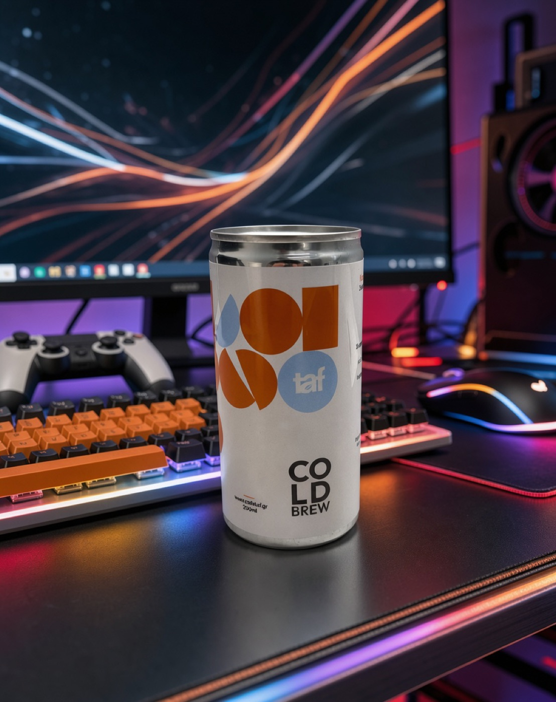
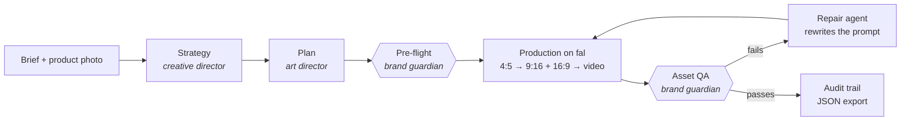
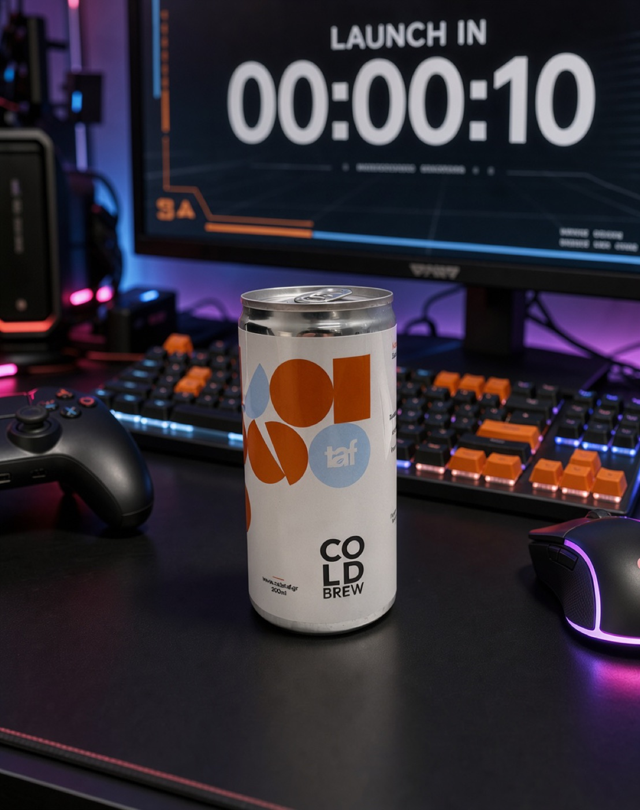
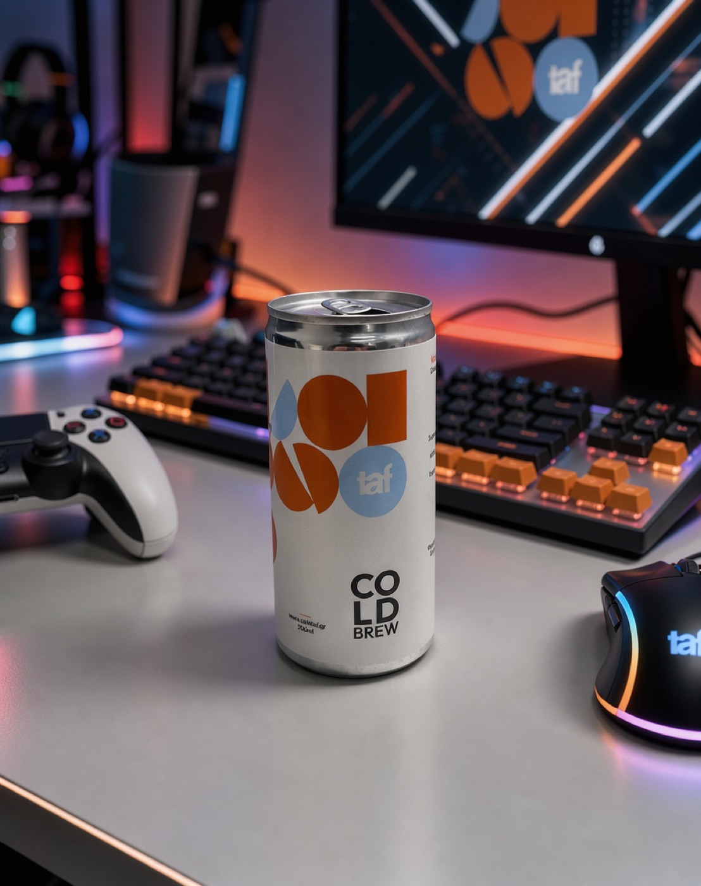
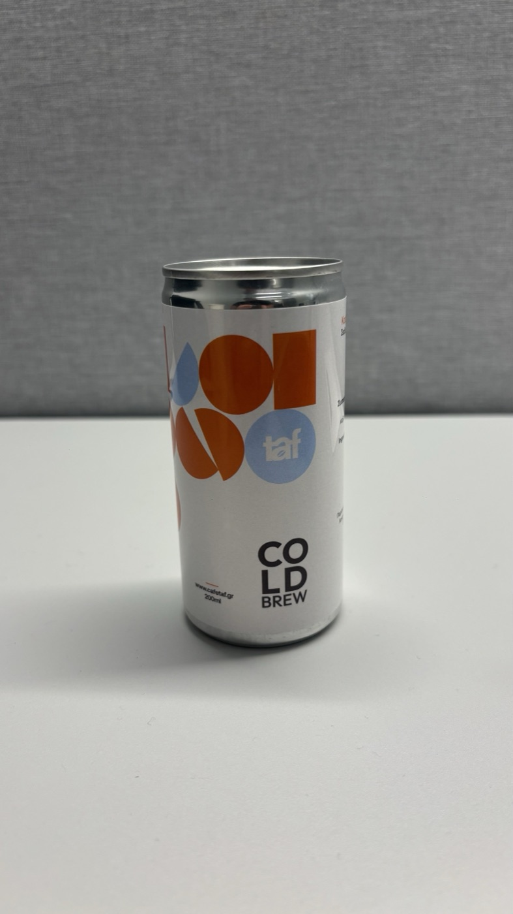
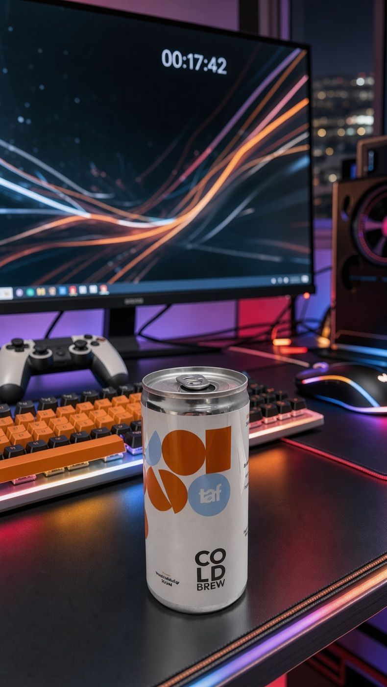
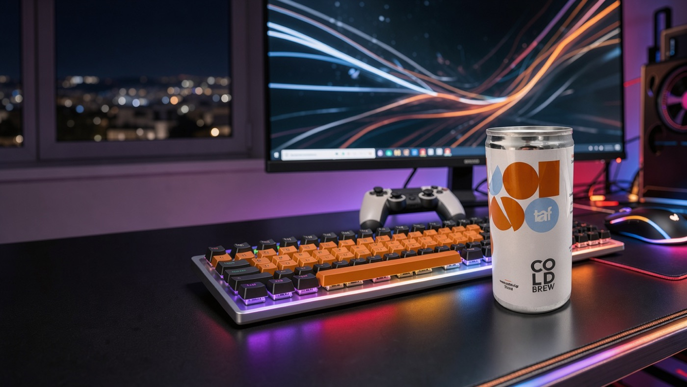

<div align="center">

# CampaignOS

**One brief in. A whole campaign out. On brand.**

From a business objective and one product photo to a campaign-ready creative package,<br>
with a brand guardian that checks and self-corrects every asset against brand, legal and channel rules.

[**Live app**](https://campaign-os-delta.vercel.app) ·
[**Website**](https://campaign-os-delta.vercel.app/website/index.html) ·
[**Demo video (2:06)**](https://campaign-os-delta.vercel.app/website/assets/demo.mp4) ·
[**Submission notes**](SUBMISSION.md)




<sub>A real output. This hero was rejected twice by the brand guardian and approved on the third attempt, with no human edits.</sub>

</div>

---

## The problem

Generative models can make a campaign in minutes, but brands can't ship it:

- **The product drifts.** The can gets wider, the logo misspells, the cap changes color between formats.
- **The copy makes claims.** "No jitters", "stay sharp", "fuel your night": health claims and clichés slip in.
- **Prompts borrow other people's IP.** Ask for a game-launch campaign and the model reaches for the game's logo, characters and city.

Today a person catches all of this by hand, asset by asset, which erases most of the speed.

## What CampaignOS does

CampaignOS splits the work the way an agency does: **creative agents create, and an independent brand guardian enforces.** The creative agents never see the rules, so they can't write right up to their edge.



| Step | Agent | What happens |
|---|---|---|
| 1. Brief | You | Brand, market, objective, audience, brand colors and one product photo. |
| 2. Strategy | Creative director | Audience insight, key message, 3 distinct concepts, plus a written record of the product's identity and the 5–8 elements that must never change. |
| 3. Plan | Art director | Shot prompts for every format, plus English and Greek copy written natively for the market. |
| 4. Pre-flight | **Brand guardian** | Checks the plan before any image is made and rewrites only the lines that fail (up to 2 rounds). Product-consistency instructions are then appended in code, so no model can drop them. |
| 5. Production | fal | The 4:5 hero first, then 9:16 and 16:9 in parallel using the hero as a style reference, then a video from the 9:16 frame. |
| 6. Asset QA | **Brand guardian** | Every image is compared with the original photo and checked against the rules. On failure, a repair agent rewrites the prompt and the image is regenerated, up to 3 attempts, then flagged for human review. |
| 7. Audit trail | **Brand guardian** | A JSON export with every rule result, every prompt and attempt, and an AI-generated disclosure. |

## A real run: "Game launch week"

The built-in demo brief is designed to cause trouble. It asks for taf Cold Brew to become the drink of the year's biggest video game launch, with the game's names (GTA, Vice City, Rockstar Games and others) on the protected list.

**Brief to finished campaign: 4:13, with 4 automatic corrections and no human edits.**

**Pre-flight** caught two rule breaks in the copy and rewrote only those lines, in English and Greek:

| Rule | Before | After |
|---|---|---|
| No functional claims | ~~Stay sharp for every mission.~~ | Chilled flavour meets your setup. |
| No functional claims | ~~Late nights, big games, no jitters. taf Cold Brew is your upgrade.~~ | Late nights, big games—taf Cold Brew brings your style. |
| Specific, not generic | ~~Level up your launch night with a cool can of taf Cold Brew.~~ | Celebrate your launch night with a cool can of taf Cold Brew. |

**Asset QA** rejected the hero image twice before approving it:

| Attempt 1: rejected | Attempt 2: rejected | Attempt 3: approved |
|:---:|:---:|:---:|
|  |  |  |
| ✕ No third-party IP: the background looks like a game's launch screen | ✕ Product identity: the can is taller and wider than the real one | ✓ All checks passed |
| *Repair: replace the countdown with abstract graphics* | *Repair: keep the slim, narrow proportions of the photo* | |

**The finished set**, all built from the approved hero:

| Product photo (input) | Stories · 9:16 | Web banner · 16:9 |
|:---:|:---:|:---:|
|  |  |  |

Plus a [video spot](https://campaign-os-delta.vercel.app/website/assets/spot.mp4) made from the 9:16 frame.

## The brand guardian's rules

Defined in [`lib/rules.js`](lib/rules.js). Each rule can be switched on or off per campaign, and protected names are added per brief.

| Group | Rule | Enforces | Checked on |
|---|---|---|---|
| Brand | Product identity | Shape, proportions, cap, logo, large text and brand colors match the photo | Every image |
| Brand | Specific, not generic | No advertising clichés such as "fuel your", "elevate", "level up" | The plan |
| Legal | No third-party IP | No trademarks, characters, places or art styles of games, films or brands, plus the protected-names list | The plan and every image |
| Legal | No violence or crime | No weapons, heists, police chases or illegal activity | The plan and every image |
| Legal | No functional claims | No health, energy, focus or performance claims, stated or implied | The plan |
| Channel | Copy fits the channels | Headline ≤ 7 words (≤ 8 in Greek), captions ≤ 125 characters, ≤ 2 hashtags | The plan, **counted in code**, not judged by a model |

## Built with

| | |
|---|---|
| **fal** · [`blackforestlabs/flux-3/edit-image`](https://fal.ai) | Product-preserving image editing for the hero, the 9:16 and 16:9 versions, and every self-correction. Each call takes the product photo, and the approved hero where relevant, as reference images. |
| **fal** · [`blackforestlabs/flux-3-max/image-to-video`](https://fal.ai) | The motion spot, made from the approved 9:16 frame. |
| **fal storage** | Product photo upload. |
| **OpenAI** · `gpt-4.1` | Strategy, plan, compliance review, vision QA and prompt repair (JSON mode). |
| **Next.js 15** · React 19 | App Router UI and API routes. No database: state lives in the browser session and exports as JSON. |

## Getting started

**Requirements:** Node.js 18.18 or later, a [fal](https://fal.ai) API key and an [OpenAI](https://platform.openai.com) API key.

```bash
git clone https://github.com/voli24/Turning-a-business-objective-into-a-complete-consistent-campaign-is-a-product.-We-built-the-product..git campaignos
cd campaignos
npm install
cp .env.local.example .env.local   # then add your keys
npm run dev                        # http://localhost:3000
```

Then click **Game launch week**, upload a product photo, and press **Generate strategy**. Choosing a concept starts the plan, pre-flight and production automatically. A full run takes about 4 minutes.

### Environment variables

| Variable | Required | Default | Purpose |
|---|---|---|---|
| `FAL_KEY` | Yes | | fal API key for images, video and uploads |
| `OPENAI_API_KEY` | Yes | | OpenAI API key for all agents |
| `OPENAI_MODEL` | No | `gpt-4.1` | Any chat model on your account that supports JSON mode and images |
| `FAL_IMAGE_MODEL` | No | `blackforestlabs/flux-3/edit-image` | Image model |
| `FAL_VIDEO_MODEL` | No | `blackforestlabs/flux-3-max/image-to-video` | Video model |

`.env.local` is git-ignored. Never commit keys.

### Deploy to Vercel

Import the repo in Vercel, add `FAL_KEY` and `OPENAI_API_KEY` under **Environment Variables**, and deploy. The image, video and pre-flight routes set `maxDuration = 300`, so long generations aren't cut off.

> **Cost note:** the app has no sign-in. Anyone with the URL can start a run on your fal and OpenAI credits. Set spending limits on both accounts before sharing a public link.

## Project structure

```
app/
  page.js              UI and orchestration: generate → check → repair → retry
  globals.css          Design tokens and layout
  api/
    strategy/          Creative director agent
    plan/              Art director agent
    preflight/         Compliance review and revision loop on the plan
    image/             fal image edit
    check/             Vision QA of an asset against the rules
    fix/               Prompt repair agent
    video/             fal image-to-video
    upload/            fal storage upload
lib/
  rules.js             Rule book, deterministic channel check, consistency guards
  llm.js               OpenAI client and JSON helper
  fal.js               fal client, model names and result helpers
public/website/        Static product website and demo assets
```

## Troubleshooting

- **Errors from fal or OpenAI** are shown in the app and in the terminal.
- **"Model not found"**: set `OPENAI_MODEL` in `.env.local` to a model your OpenAI account has.
- **"Authorization header is required" on upload**: `FAL_KEY` is missing from `.env.local` (locally) or from the Vercel environment variables.

## What's next

- Rule books loaded from a brand's guidelines PDF instead of a fixed list.
- More channels and languages, with per-channel safe zones checked on the image.
- A reviewer inbox for assets flagged for human review.

---

<div align="center"><sub>Built for the fal track. All campaign images shown here are AI-generated and come from one recorded run.</sub></div>
